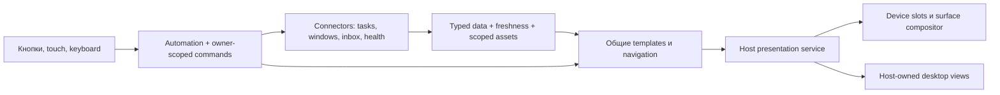

# Представления данных и пользовательские views

Статус: целевой контракт для общих presenters; реальные surface/desktop adapters появятся в Фазах 9/13. [Pre-6 gate](../implementation/pre-phase-6.md) требует модель и независимые fixtures до фиксации editor API. [ADR-0018](../decisions/0018-interaction-ui-runtime.md) сохраняет host ownership окон.

## Данные отдельно от представления

Общий presenter — системная служба host с versioned port, shared render resources и bounded contexts на view/slot. Стандартные templates могут поставляться bundled package; data providers зависят от schema/model contract, а не от установки конкретного renderer backend. Нельзя запускать отдельный web runtime для каждого number/badge. Custom renderer остаётся изолированным optional runtime; его crash не останавливает data source и стандартные views.

Provider выдаёт typed state, collection query, domain commands и icon/asset references. Presenter выбирает text/icon/gauge/chart/list/scene template и mapping на доступную geometry. Task/weather/MQTT logic не находится в renderer. Scene templates допускают schema-defined customization; только специальное содержимое требует custom web runtime.

Bounded view model содержит schema/version, source identity/revision, units, valid/observed time и freshness. Icons/цвет/текст не загружаются renderer по произвольным filesystem paths или network URLs: package assets, scoped runtime asset lease либо bounded broker response. Размер, MIME, digest, cache policy и lifetime определены. Долгая view держит свой read lease; artifact исходного run не сохраняется навечно автоматически. Private data не попадают в trace, а unavailable имеет отдельный вид от 0/false.

Графики используют ограниченное окно samples и выбранную aggregation policy; discontinuity/reset/clock shift видны, не интерполируются как настоящие измерения. Render frequency отделена от sampling и reliable events. При скрытой view subscription приостанавливается/освобождается по policy. Locale/timezone/units заданы данными и настройками, не зашиты в пиксели provider.

## Коллекции, подменю и навигация

Общая модель обслуживает задачи, окна, notes и Telegram. Page имеет scope (account/filter/provider generation), item IDs/revisions, snapshot/watermark или честный best-effort consistency marker. Сервер с offset pagination без snapshot не выдаётся за консистентный snapshot: adapter дедуплицирует и делает bounded refresh при изменении списка.

View хранит navigation stack, selected item, page cursor и displayed revision. Render и hit binding публикуются как одна presentation revision. Нажатие адресует stable item ID и revision, а не текущий индекс массива. Press фиксирует visual/input owner; release после перестановки/смены scene доставляется прежнему owner. Если provider не принимает expected item revision, adapter повторно читает/сверяет перед write и показывает race/unknown ограничения; core не изобретает внешнюю транзакцию.

Back/home/next/previous и item action menu — общие команды presenter. Любая mutation ещё раз проверяет grants и item identity. Disabled/missing/loading/stale/error/empty состояния типизированы. Удаление и другие destructive actions используют заданную confirmation policy; UI repaint не считается пользовательским подтверждением. Две surfaces могут иметь независимую navigation state при общем источнике данных.

## Виджет в отдельной кнопке или области

Stable SlotId принадлежит layout/scene, WidgetInstanceId — настроенному содержимому slot. Slot может содержать ordered set виджетов и runtime active selection: next/previous/select, manual или timed rotation. Переход изменяет только эту область и её hit bindings; он не перезапускает whole scene/workspace и не сбрасывает соседние controls. Settings/набор виджетов меняется через draft/apply, active selection — через scoped presentation operation.

На press фиксируются slot/widget/presentation revision и выбранное действие. Смена содержимого не передаёт этот же жест новому widget; release/held-output cleanup относится прежнему owner. Click-to-cycle и widget domain action имеют явное gesture mapping. Local page/selection resume policy задаётся; hidden widgets освобождают render/timer/subscription leases по policy, shared data source остаётся жив при других consumers. Rotation останавливается при hold/selection/edit, screen lock или hidden view; пропущенные ticks не проигрываются пачкой.

Unread badges/counts/list, часы, countdown, health gauges и новости используют тот же механизм. Auto-rotation — presentation policy, она не выполняет read/ack внешнего сервиса. Render budgets и cache объединяются для одинаковых assets/fonts; idle view не требует постоянного redraw.

## Scene selection и временные режимы

Выбор уже скомпилированной scene/binding group — runtime operation с device-group scope и owner token. Он не переписывает draft, package lock и active workspace revision. Новые nodes/settings/packages требуют обычного apply. Приоритеты manual/context/temporary policies и возврат задаются явно; temporary pop снимает свой token, не произвольный верхний слой.

Scene selection атомарно меняет согласованную presentation/input revision на стороне host. Физический экран может обновиться позже; hit event содержит доступную presented revision/owner evidence либо обрабатывается по явно объявленной conservative policy. Для игры нельзя приписывать старому пикселю нового target. Frame ACK означает ровно объявленную transport/device guarantee, не автоматически доказанный photon-visible момент. [Frames](lifecycle.md#frames-и-preview), [layers](automation.md#слои-и-удерживаемые-outputs).

## Короткие interactions и постоянные desktop views

`InteractionSession` — конечный picker/form/confirm с owner invocation, deadline и typed selected/cancelled result. Для Zotero окно открывается до готовности provider; query сохраняется, смена query повышает generation, поздняя page отбрасывается. Prepare/startup не крадёт focus у уже открытого поля ввода.

`DesktopViewSession` — отдельная планируемая сущность для notes/dashboard/always-on-top. Её owner — workspace + view instance + provider lease, а не вечный ожидающий automation invocation. View может жить после завершения edit job и при закрытом главном editor. Restore после restart требует enabled policy и текущих grants; private content не показывается автоматически на чужом screen/account.

Host presentation adapter владеет placement, focus, z-order, monitor/DPI remapping, keyboard accessibility, visibility и close. Default passive view не перехватывает ввод; edit mode получает focus по явному действию. Click-through/always-on-top — ограниченные host policies, не произвольные native window flags от plugin. Tray Exit закрывает все views; revoke/disable/provider fault показывает bounded unavailable state или закрывает view по policy и освобождает subscriptions. Closing view не удаляет notes.

Custom web content наследует origin/partition/bridge ограничения Widget/Interaction runtime. Data provider не получает Tauri/window API. Screen capture/pixel sample требует отдельного scoped capability; создание overlay не выдаёт доступ к экрану. Idle frame throttling, limits views/bytes/FPS и screen-lock privacy проверяются до реального presenter.

## Приёмка

Fake presenter до Фазы 6 проверяет один data source на двух devices, reorder/delete между render и click, page refresh, slot/scene switch при hold, независимость соседних slots и отдельные lifetimes edit/view/data. Реальные adapters добавляют mixed DPI, missing monitor, focus restrictions, screen lock, frame loss/ACK, web isolation и закрытие главного окна без потери разрешённой persistent view. Пипетка и игра — [conformance scenarios](../plugins/productivity.md), а не исключения из этих правил.
